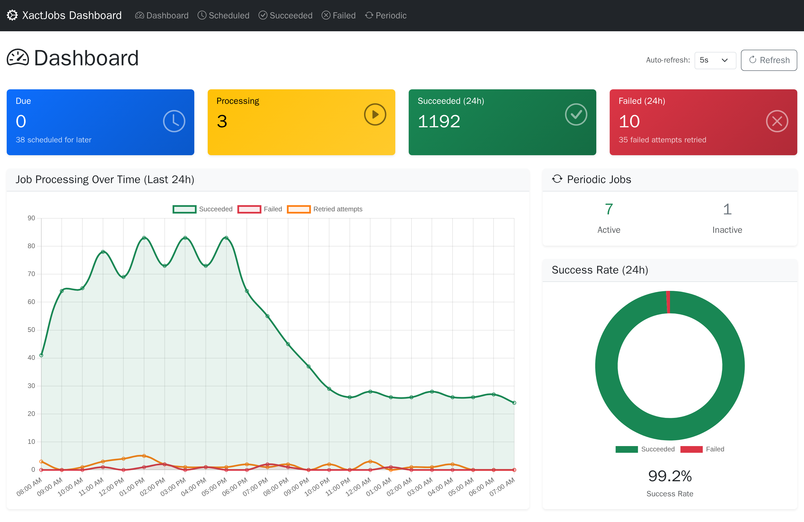
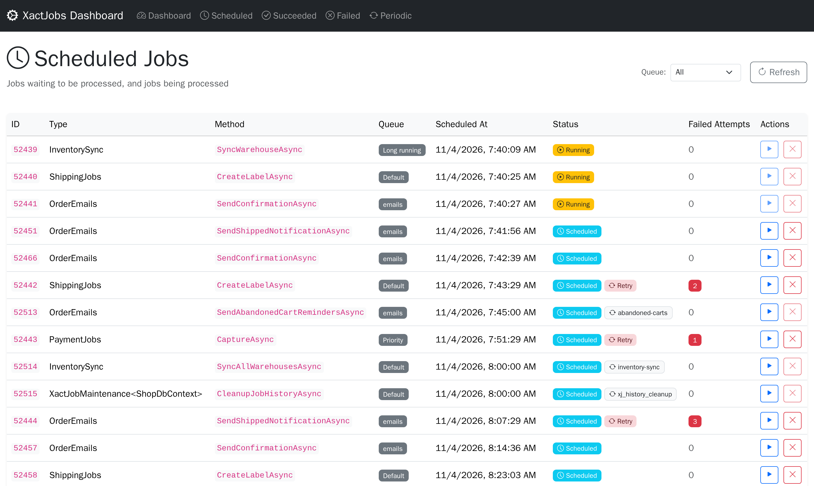
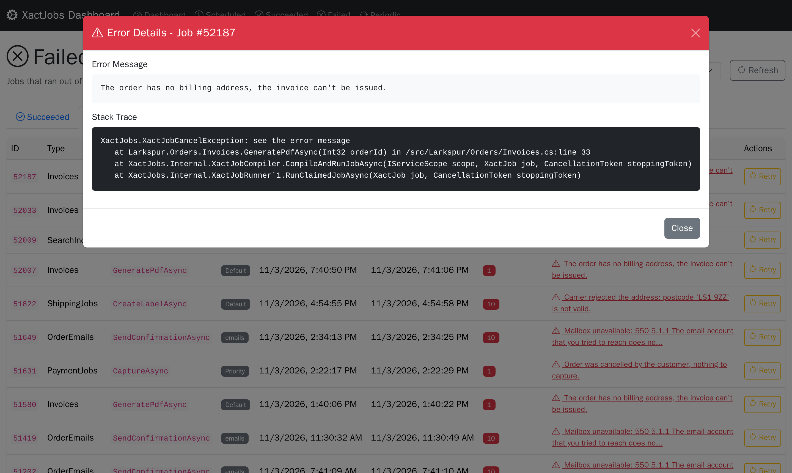
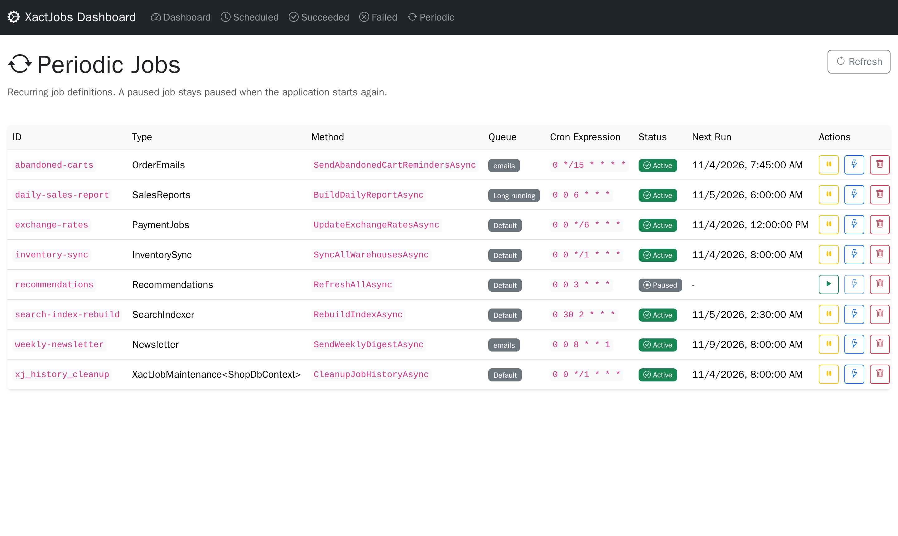
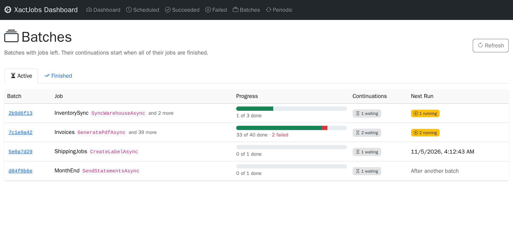
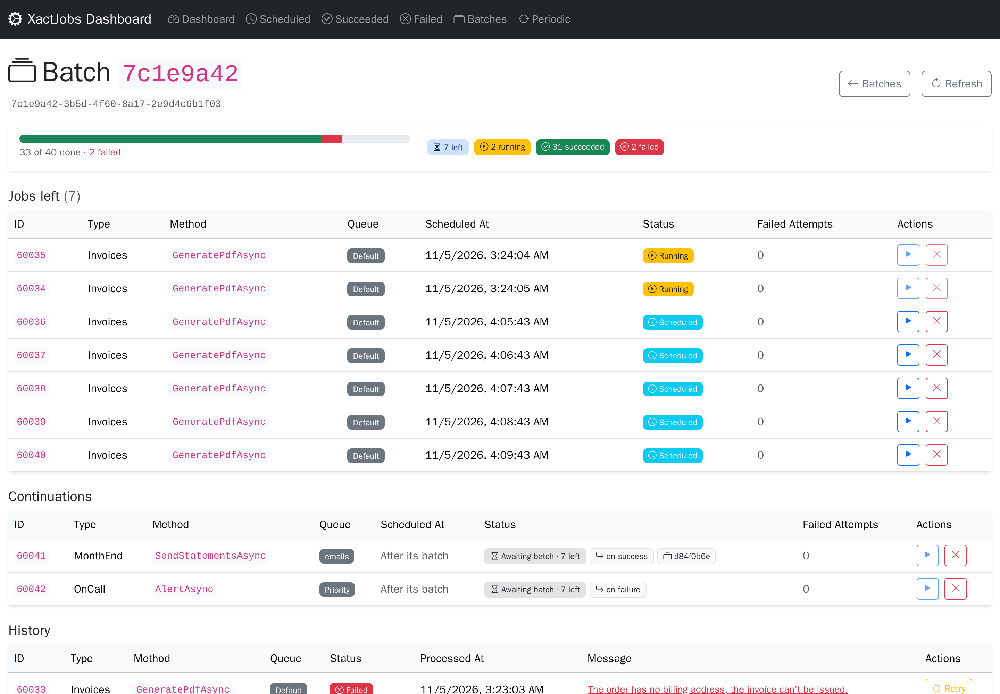

# XactJobs
XactJobs lets you schedule and run background jobs **with full database transaction support** using EntityFrameworkCore. 
Jobs are saved alongside your business data and only execute if your transaction commits - no more “ghost” jobs on rollback.

Supports **SQL Server, PostgreSQL, MySQL, Oracle and SQLite**, on .NET 8, 9 and 10.

XactJobs uses EF Core 9 on .NET 8 and 9, and EF Core 10 on .NET 10, so your database provider has to support that version. For MySQL, see [which provider to use](#mysql).

The docs are also on the website, page by page: [xactjobs.com](https://xactjobs.com/).

## A Job Is a Unit of Work
**The worker saves a job's database changes, not the job.** Changes a job makes through the injected `TDbContext` are saved when the job finishes, in the same transaction that marks it as completed:

- **Exactly once.** If a lease expires and another worker runs the job again, only one of the runs can commit, so the changes happen once.
- **No transaction stays open while the job runs**, unless the job opens one. The changes wait in EF's change tracker, and are written at the end in one short transaction.
- **Don't call `SaveChanges` in a job**, or call it only inside a transaction you open and don't commit: the worker commits it. Changes saved any other way are permanent right away, even if the job then fails.
- **Returning saves.** Returning normally, even early, saves the pending changes and records the job as completed. A job that wants to stop without saving must throw instead.
- **Throwing discards.** Any exception discards the pending changes, and the job is retried. To stop a job that can never succeed, e.g. because the data it works on is gone, throw `XactJobCancelException`: its changes are discarded too, but it isn't retried, and it moves to the history as cancelled, with the exception's message.

```csharp
public class InvoiceJob(UserDbContext db)
{
    public async Task CreateInvoiceAsync(int orderId)
    {
        var order = await db.Orders.FindAsync(orderId)
            ?? throw new XactJobCancelException($"Order {orderId} doesn't exist anymore");

        db.Invoices.Add(new Invoice(order.Id)); // no SaveChanges: the worker saves it when the job finishes
    }
}
```

The details are in [Exactly-Once Database Effects](#exactly-once-database-effects), and for `XactJobCancelException` in [Failures and Retries](#failures-and-retries).

## Status
XactJobs is pre-1.0. The core is tested on all five databases, with an integration test suite running against each one (SQLite in-process, the others in containers): transactional enqueue, picking up jobs with leases, retries, batches and continuations, and periodic jobs.

Until 1.0:
- **The API can still change** between minor versions (0.x). Breaking changes are listed in the release notes, with how to migrate.
- **Schema changes ship as SQL scripts**, one per version and database, with [upgrade notes](#installation) in this README. Existing data is always kept.
- **1.0 freezes the API and the schema** under semantic versioning.

Feedback and issue reports are very welcome, especially from production use.

XactJobs was started in 2025, and written without AI. Newer releases are developed with AI, and the changes are reviewed by a human.

## Features
The examples below use this simple job:

```csharp
public static class Greeter
{
    public static void Say(string message) => Console.WriteLine(message);
}
```

### Fire and Forget Jobs
Fire-and-forget jobs are executed once by a background worker, in its next poll. Each worker polls every 6 seconds by default (`WithPollingInterval`),
and the workers of a queue take turns, so with the default 2 workers the queue is polled every 3 seconds. [QuickPoll](#quickpoll) runs a job right away.

```csharp
// ... other business logic
dbContext.JobEnqueue(
    () => Greeter.Say("Fire-and-forget!"));

dbContext.SaveChanges();
```

### Delayed Jobs
Delayed jobs are executed once after the specified time interval.

```csharp
dbContext.JobScheduleIn(
    () => Greeter.Say("Delayed!"),
    TimeSpan.FromDays(7));

dbContext.SaveChanges();
```

### Recurring jobs
Recurring jobs run periodically according to the specified cron schedule.

```csharp
dbContext.JobEnsurePeriodic(
    () => Greeter.Say("Recurring!"),
    "my_recurring_job",
    Cron.Daily());

dbContext.SaveChanges();
```

If the periodic jobs are known at startup, define them in the options instead:

```csharp
builder.Services.AddXactJobs<UserDbContext>(options =>
{
    options.WithPeriodicJob(
        () => Greeter.Say("Recurring!"),
        "my_recurring_job",
        Cron.Daily());
});
```

This is the safe way to do it with several nodes starting at the same time, because the nodes take turns under a lock.
`JobEnsurePeriodic` can't take that lock, since the changes are only saved later by your `SaveChanges`. If several nodes
call it at the same time, it's still safe for an existing job (only the definition saved last runs), but for a new job all of them
except the first get a duplicate key error from `SaveChanges`.

Each run of a periodic job schedules the next one. Each node also checks every 5 minutes (`WithPeriodicJobReconciliationInterval`)
for active periodic jobs without a pending run, and schedules their next run. So a periodic job recovers if its pending
row gets lost, and rows added directly to the periodic job table are picked up. They need a valid cron expression, and the same
type name, method name and arguments format that XactJobs writes. The run happens at the next time on the cron schedule,
missed runs are not caught up.

After a periodic job is deleted, or its definition changes, the pending run of the old definition stays in the table until its
scheduled time. A worker then skips it, adding a `Skipped` row to the history.

#### State Between Runs

A run can leave a short state for the next run of the same periodic job, e.g. a watermark or a cursor. It gets it in
`XactJobContext.PeriodicState`, and sets the next one with `SetPeriodicState`. The invoices and the state are saved together:

```csharp
public class InvoiceRun(AppDbContext db)
{
    public async Task CreateInvoicesAsync(XactJobContext context, CancellationToken cancellationToken)
    {
        // the last order the previous runs invoiced
        var lastOrderId = long.Parse(context.PeriodicState ?? "0");

        var orders = await db.Orders
            .Where(o => o.Id > lastOrderId)
            .OrderBy(o => o.Id)
            .Take(500)
            .ToListAsync(cancellationToken);

        if (orders.Count == 0) return;

        db.Invoices.AddRange(orders.Select(Invoice.For));

        context.SetPeriodicState(orders[^1].Id.ToString());
    }
}

dbContext.JobEnsurePeriodic<InvoiceRun>(
    x => x.CreateInvoicesAsync(null!, CancellationToken.None),
    "invoices",
    Cron.MinuteInterval(5));
```

- The state is saved with the run's own changes, in the same transaction, and only if the run completes. A failed attempt leaves it as
  it was, and its retry gets the same state.
- A run that doesn't call `SetPeriodicState` keeps the state, and `null` clears it.
- At most 2,000 characters (`XactJobPeriodic.MaxStateLength`). A longer one throws `ArgumentException`, which fails the attempt.
- It belongs to the periodic job's id: a new definition, pausing and resuming keep it, and deleting the periodic job deletes it.
  `JobEnsurePeriodic` and `WithPeriodicJob` never change it. To change it outside a run, update the `state` column of the periodic job
  table.
- The history has each run's state, before and after the run.
- Only runs of periodic jobs have a state: in other jobs `PeriodicState` is null, and `SetPeriodicState` throws
  `InvalidOperationException`. The dashboard can't retry a run that had a state, because it would run as a one-off job, without it.

### Several Jobs at Once
Adding multiple jobs before saving changes will enqueue all jobs in a single transaction.

```csharp
dbContext.JobEnqueue(() => Greeter.Say("Job 1"));
dbContext.JobEnqueue(() => Greeter.Say("Job 2"));

dbContext.SaveChanges();
```

### Continuations
A continuation is a job that starts when another job is finished. It can have continuations of its own:

```csharp
dbContext.JobEnqueue<Importer>(x => x.ImportAsync(fileId))
    .ContinueWith<Reports>(x => x.RebuildAsync())
    .ContinueWith<Mailer>(x => x.SendReportAsync());

dbContext.SaveChanges();
```

By default a continuation runs if the job succeeded. The condition can also be `OnFailure` or `OnFinish`, and a continuation can go to another queue:

```csharp
var import = dbContext.JobEnqueue<Importer>(x => x.ImportAsync(fileId));

import.ContinueWith<Reports>(x => x.RebuildAsync());
import.ContinueWith<Ops>(x => x.AlertAsync(fileId), XactJobContinuation.OnFailure, QueueNames.Priority);
```

| Condition | Runs when |
|---|---|
| `OnSuccess` (default) | all the jobs it waits for succeeded |
| `OnFailure` | at least one of them failed |
| `OnFinish` | they are all finished, whether they succeeded or not |

A job failed if it ran out of retries, threw `XactJobCancelException`, was cancelled from the dashboard, or was a continuation that was skipped,
so in a chain of `OnSuccess` continuations, a failure skips the rest of the chain. A continuation whose condition isn't met moves to the history as `Skipped`,
with the reason as its message. Attempts that were retried don't count: a job of a batch that succeeds on its second attempt succeeded.

A job can only be continued before it's saved, because its row can't be changed afterwards. To continue jobs that are saved separately, put them in a batch.

### Batches
A batch is a group of jobs whose continuations start when all of them are finished:

```csharp
var batch = dbContext.JobBatch()
    .Enqueue<InventorySync>(x => x.SyncAsync("leeds"))
    .Enqueue<InventorySync>(x => x.SyncAsync("reno"))
    .ScheduleIn<InventorySync>(x => x.SyncAsync("osaka"), TimeSpan.FromHours(2));

batch.ContinueWith<Reports>(x => x.RebuildAsync())
    .ContinueWith<Mailer>(x => x.SendReportAsync());

batch.ContinueWith<Ops>(x => x.AlertAsync(), XactJobContinuation.OnFailure);

dbContext.SaveChanges();
```

The jobs of a batch are saved together, with one `SaveChanges`: once it's saved, a batch can't get more jobs. Continuations can be added at any time, also later by
the batch's id (`batch.Id`). If the batch is already finished, they start right away:

```csharp
dbContext.JobBatch(batchId)
    .ContinueWith<Audit>(x => x.LogAsync(batchId), XactJobContinuation.OnFinish);

dbContext.SaveChanges();
```

A batch id that doesn't exist is a finished batch without jobs, so its continuations run as if all of its jobs succeeded.

- A retry of a job stays in its batch, and a continuation waits for it. A job retried from the dashboard is a new job, outside of the batch.
- A job of a batch can't be continued on its own: continue the batch. Periodic jobs can't be in a batch, nor be continued.
- A skipped continuation can be retried from the dashboard: it runs as a new job, outside of any batch.
- The worker that finishes the last job of a batch wakes up the workers of the continuations' queues, if they run in the same process,
  and the continuations start as soon as a worker is free. Besides that, each worker checks for continuations of finished batches once per polling interval.
  The check is one query, which looks at every continuation of the queue that's still waiting, so keep it in mind with many thousands of them.
- A continuation that waits for its batch is stored with the scheduled time 9999-12-31, so the poll for due jobs never reaches it.
- With QuickPoll, `JobBatch()` registers the jobs of the batch for the notification. Their continuations don't need it.
- The history cleanup, if you turn it on (see [Configuration](#configuration)), keeps the history of the batches that continuations still wait for, since it tells if their jobs failed.

### Transactions
Jobs participate in DbContext transactions, just like the regular entities in EFCore.

```csharp
using var tx = dbContext.Database.BeginTransaction();

// some business logic
dbContext.JobEnqueue(() => Greeter.Say("Job 1"));
dbContext.SaveChanges();

// some more business logic
dbContext.JobEnqueue(() => Greeter.Say("Job 2"));
dbContext.SaveChanges();

tx.Commit();
```
### Isolated Queues
XactJobs can be configured to run isolated workers for named queues.
```csharp
dbContext.JobEnqueue(() => Greeter.Say("Job 1"), QueueNames.Priority);
dbContext.JobEnqueue(() => Greeter.Say("Job 2"), QueueNames.LongRunning);

dbContext.SaveChanges();
```

A queue's jobs only run on its workers, so each queue needs them in the options: `WithPriorityQueue()`, `WithLongRunningQueue()`, or
`WithIsolatedQueue("name")` for a queue of your own (see [Configuration](#configuration)).

### QuickPoll
QuickPoll can be used if a job should be executed immediately, without waiting for the next poll interval.
QuickPoll instance is registered as a scoped service so it can be injected in class constructors, just like the DbContext instances.

```csharp
public class YourWorkerOrController
{
    private readonly QuickPoll<UserDbContext> _quickPoll;
    private readonly UserDbContext _dbContext;

    public YourWorkerOrController(QuickPoll<UserDbContext> quickPoll)
    {
        _quickPoll = quickPoll;
        _dbContext = quickPoll.DbContext;
    }

    public async Task YourBusinessLogic()
    {
        // Your business logic uses _dbContext, as usual.

        // Enqueue the job through _quickPoll (instead of DbContext)
        _quickPoll.JobEnqueue(() => Greeter.Say("QuickPoll"));

        // Save changes through _quickPoll
        // (this calls DbContext.SaveChanges and notifies the workers)
        _quickPoll.SaveChangesAndNotify(); 
    }
}
```
This can only work if the workers are running in the same process where the jobs are enqueued (which is the default).

A job enqueued this way is scheduled for the current time of the application. If that's still in the future for the database when
the worker polls (the clocks differ, or on SQLite within the same millisecond), the job runs at the next regular poll.

# Installation

Install the XactJobs nuget package:  
```
dotnet add package XactJobs
```

Add Entity Configurations to your DbContext:
```csharp
public class UserDbContext: DbContext
{
    // Your DbSets...

    protected override void OnModelCreating(ModelBuilder modelBuilder)
    {
        modelBuilder.ApplyXactJobsConfigurations(Database.ProviderName);

        // Apply your entity configurations...
    }
}
```

Register XactJobs with your service provider
```csharp
// This registers 2 workers for the default queue
builder.Services.AddXactJobs<UserDbContext>(options =>
{
    options.WithPriorityQueue();     // optional (2 additional workers)
    options.WithLongRunningQueue();  // optional (2 additional workers)
});
```

Finally create the XactJobs tables in your database. For a new installation, run the install script for your database, which creates the
latest schema. To upgrade an existing installation, run the versioned scripts newer than its version, in version order, with the notes below.
The install script creates the same schema as all the versioned scripts.

| Database | New installation | Upgrade |
|---|---|---|
| SQL Server | [xact-jobs-sqlserver.sql](https://github.com/XactJobs/XactJobs/blob/main/sql/install/xact-jobs-sqlserver.sql) | [v0.1.0](https://github.com/XactJobs/XactJobs/blob/main/sql/v0.1.0/xact-jobs-sqlserver-v0.1.0.sql), [v0.1.4](https://github.com/XactJobs/XactJobs/blob/main/sql/v0.1.4/xact-jobs-sqlserver-v0.1.4.sql), [v0.1.5](https://github.com/XactJobs/XactJobs/blob/main/sql/v0.1.5/xact-jobs-sqlserver-v0.1.5.sql), [v0.2.0](https://github.com/XactJobs/XactJobs/blob/main/sql/v0.2.0/xact-jobs-sqlserver-v0.2.0.sql), [v0.3.0](https://github.com/XactJobs/XactJobs/blob/main/sql/v0.3.0/xact-jobs-sqlserver-v0.3.0.sql), [v0.4.0](https://github.com/XactJobs/XactJobs/blob/main/sql/v0.4.0/xact-jobs-sqlserver-v0.4.0.sql), [v0.5.0](https://github.com/XactJobs/XactJobs/blob/main/sql/v0.5.0/xact-jobs-sqlserver-v0.5.0.sql), [v0.6.0](https://github.com/XactJobs/XactJobs/blob/main/sql/v0.6.0/xact-jobs-sqlserver-v0.6.0.sql) |
| PostgreSQL | [xact-jobs-postgresql.sql](https://github.com/XactJobs/XactJobs/blob/main/sql/install/xact-jobs-postgresql.sql) | [v0.1.0](https://github.com/XactJobs/XactJobs/blob/main/sql/v0.1.0/xact-jobs-postgresql-v0.1.0.sql), [v0.1.4](https://github.com/XactJobs/XactJobs/blob/main/sql/v0.1.4/xact-jobs-postgresql-v0.1.4.sql), [v0.1.5](https://github.com/XactJobs/XactJobs/blob/main/sql/v0.1.5/xact-jobs-postgresql-v0.1.5.sql), [v0.2.0](https://github.com/XactJobs/XactJobs/blob/main/sql/v0.2.0/xact-jobs-postgresql-v0.2.0.sql), [v0.3.0](https://github.com/XactJobs/XactJobs/blob/main/sql/v0.3.0/xact-jobs-postgresql-v0.3.0.sql), [v0.4.0](https://github.com/XactJobs/XactJobs/blob/main/sql/v0.4.0/xact-jobs-postgresql-v0.4.0.sql), [v0.5.0](https://github.com/XactJobs/XactJobs/blob/main/sql/v0.5.0/xact-jobs-postgresql-v0.5.0.sql), [v0.6.0](https://github.com/XactJobs/XactJobs/blob/main/sql/v0.6.0/xact-jobs-postgresql-v0.6.0.sql) |
| MySQL | [xact-jobs-mysql.sql](https://github.com/XactJobs/XactJobs/blob/main/sql/install/xact-jobs-mysql.sql) | [v0.1.0](https://github.com/XactJobs/XactJobs/blob/main/sql/v0.1.0/xact-jobs-mysql-v0.1.0.sql), [v0.1.4](https://github.com/XactJobs/XactJobs/blob/main/sql/v0.1.4/xact-jobs-mysql-v0.1.4.sql), [v0.1.5](https://github.com/XactJobs/XactJobs/blob/main/sql/v0.1.5/xact-jobs-mysql-v0.1.5.sql), [v0.2.0](https://github.com/XactJobs/XactJobs/blob/main/sql/v0.2.0/xact-jobs-mysql-v0.2.0.sql), [v0.3.0](https://github.com/XactJobs/XactJobs/blob/main/sql/v0.3.0/xact-jobs-mysql-v0.3.0.sql), [v0.5.0](https://github.com/XactJobs/XactJobs/blob/main/sql/v0.5.0/xact-jobs-mysql-v0.5.0.sql), [v0.6.0](https://github.com/XactJobs/XactJobs/blob/main/sql/v0.6.0/xact-jobs-mysql-v0.6.0.sql) |
| Oracle | [xact-jobs-oracle.sql](https://github.com/XactJobs/XactJobs/blob/main/sql/install/xact-jobs-oracle.sql) | [v0.1.0](https://github.com/XactJobs/XactJobs/blob/main/sql/v0.1.0/xact-jobs-oracle-v0.1.0.sql), [v0.1.4](https://github.com/XactJobs/XactJobs/blob/main/sql/v0.1.4/xact-jobs-oracle-v0.1.4.sql), [v0.1.5](https://github.com/XactJobs/XactJobs/blob/main/sql/v0.1.5/xact-jobs-oracle-v0.1.5.sql), [v0.2.0](https://github.com/XactJobs/XactJobs/blob/main/sql/v0.2.0/xact-jobs-oracle-v0.2.0.sql), [v0.3.0](https://github.com/XactJobs/XactJobs/blob/main/sql/v0.3.0/xact-jobs-oracle-v0.3.0.sql), [v0.5.0](https://github.com/XactJobs/XactJobs/blob/main/sql/v0.5.0/xact-jobs-oracle-v0.5.0.sql), [v0.6.0](https://github.com/XactJobs/XactJobs/blob/main/sql/v0.6.0/xact-jobs-oracle-v0.6.0.sql) |
| SQLite | [xact-jobs-sqlite.sql](https://github.com/XactJobs/XactJobs/blob/main/sql/install/xact-jobs-sqlite.sql) | [v0.1.0](https://github.com/XactJobs/XactJobs/blob/main/sql/v0.1.0/xact-jobs-sqlite-v0.1.0.sql), [v0.1.4](https://github.com/XactJobs/XactJobs/blob/main/sql/v0.1.4/xact-jobs-sqlite-v0.1.4.sql), [v0.1.5](https://github.com/XactJobs/XactJobs/blob/main/sql/v0.1.5/xact-jobs-sqlite-v0.1.5.sql), [v0.2.0](https://github.com/XactJobs/XactJobs/blob/main/sql/v0.2.0/xact-jobs-sqlite-v0.2.0.sql), [v0.3.0](https://github.com/XactJobs/XactJobs/blob/main/sql/v0.3.0/xact-jobs-sqlite-v0.3.0.sql), [v0.4.0](https://github.com/XactJobs/XactJobs/blob/main/sql/v0.4.0/xact-jobs-sqlite-v0.4.0.sql), [v0.5.0](https://github.com/XactJobs/XactJobs/blob/main/sql/v0.5.0/xact-jobs-sqlite-v0.5.0.sql), [v0.6.0](https://github.com/XactJobs/XactJobs/blob/main/sql/v0.6.0/xact-jobs-sqlite-v0.6.0.sql) |

On SQL Server, run the scripts with `QUOTED_IDENTIFIER` and `ANSI_NULLS` on, which are SqlClient's and SSMS's defaults (`sqlcmd` needs `-I`): the job table has a filtered index.

When upgrading an existing installation, run only the versioned scripts of the newer versions. For v0.1.5, upgrade all the workers first and then run
the script, because it drops an index that older versions need.

For v0.2.0, run the script first: it adds the columns for batches and continuations, which v0.2.0 needs. Start using batches and continuations only
once all the workers run v0.2.0: a worker of an older version that retries a job of a batch removes the job from its batch, so the batch's continuations could start too early.

For v0.6.0, run the script first: it adds the columns for the state of periodic jobs (see [State Between Runs](#state-between-runs)),
which v0.6.0 writes, in the history on every attempt. A worker of an older version runs the jobs without their state, and leaves the
history's state columns empty.

v0.6.0 also keeps a job's id across its retries and the dashboard's *Run now* (the row moves to its new time, instead of being replaced by
a new one), so the history has a row per attempt with the same id. On SQLite, the script copies the history into a table whose primary key
is the id and the time it was processed, as on the other databases: without it, the second attempt of a job can't be recorded.

For v0.5.0, run the script first: it adds a column for the trace that enqueued a job (see [Metrics, Traces and Logs](#metrics-traces-and-logs)),
which v0.5.0 writes. A worker of an older version leaves it empty in the retries and the history.

For v0.4.0, the script can run before or after the workers are upgraded. On PostgreSQL, SQL Server and SQLite, it rebuilds the indexes of the
batch columns, in the job table and the history, so that they hold only the rows of batches and continuations: the other jobs' inserts
and deletes don't write to them. There's no script for MySQL, which has no filtered indexes, nor for Oracle, whose indexes already leave
out those rows. On SQL Server, run it with `QUOTED_IDENTIFIER` and `ANSI_NULLS` on.

For v0.3.0, run the script first: it adds the column for the time a job was originally scheduled for, which v0.3.0 needs. Then upgrade the
workers. A worker of an older version that retries a job leaves the column empty, so that retry sees its own retry time as
`XactJobContext.OriginallyScheduledAt`. On SQLite, the script also adds an index on the queue and the scheduled time, for picking up due
jobs: without it, every poll reads and sorts the whole job table. Except on MySQL, it also adds an index of the periodic job column, with
only the runs of periodic jobs, so that pausing a periodic job, resuming it, the reconciliation and the dashboard's Periodic page don't read
the whole table. On SQL Server it changes the column from `nvarchar(max)`, which can't be indexed, to `nvarchar(450)`, the type of the
periodic job's id, and it's a filtered index: creating it, and writing to the table, needs `QUOTED_IDENTIFIER` and `ANSI_NULLS` on, which
are SqlClient's defaults (`sqlcmd` needs `-I`). The dashboard's API identifies a pending job by its primary key now: see [API](#api).

## Using EF Migrations
Alternatively, instead of creating the tables with the scripts above, you can include the XactJobs entities in EF migrations like this:
```csharp
public class UserDbContext: DbContext
{
    // Your DbSets...

    protected override void OnModelCreating(ModelBuilder modelBuilder)
    {
        modelBuilder.ApplyXactJobsConfigurations(Database.ProviderName,
            excludeFromMigrations: false); // <--- key part here

        // Apply your entity configurations...
    }
}
```
And then create the migration like you normally would:
```bash
dotnet ef migrations add XactJobsTables
```

## Several Apps in One Database
On PostgreSQL and SQL Server, XactJobs' tables are in their own schema: `xact_jobs` on PostgreSQL, `XactJobs` on SQL Server. Apps that
share a database each need their own tables, or their workers would run each other's jobs. Give each app a schema of its own:

```csharp
modelBuilder.ApplyXactJobsConfigurations(Database.ProviderName, schema: "app_b");
```

The workers take the schema from the model. With the SQL scripts, replace `xact_jobs` (or `XactJobs`) with your schema before you run
them; EF migrations use it on their own. On PostgreSQL the name must be lowercase.

On MySQL, Oracle and SQLite there's no schema option: give each app its own database (on Oracle, its own user), which already has its
own tables.

# Jobs

A job is simply a public method. It can be either a static or an instance method, but it must be public and:
- it must not be a generic method,
- it cannot have `out` or `ref` parameters,
- it cannot have parameters that are anonymous functions, delegates, or lambda expressions,
- if it is an async method, it cannot be `async void` (it must be `async Task`),

Job method parameters are evaluated immediately and serialized using `System.Text.Json.JsonSerializer`.
This means parameters can be both primitives or complex objects, although large objects should be avoided as they require more storage and take longer to serialize/deserialize.

## Job Examples

### Static methods

```csharp
class EmailHelper
{
    // example 1
    public static void SendEmail(string from, string to, string body)
    {
        // ... mail sending logic
    }

    // example 2
    public static async Task SendEmailAsync(string from, string to, string body, CancellationToken cancellationToken)
    {
        // ... mail sending logic
    }
}
```

These jobs can be scheduled with:

```csharp
// example 1
dbContext.JobEnqueue(
    () => EmailHelper.SendEmail("bob@acme.com", "alice@acme.com", "Hello Alice"));

// example 2
dbContext.JobEnqueue(
    () => EmailHelper.SendEmailAsync("bob@acme.com", "alice@acme.com", "Hello Alice", CancellationToken.None));

dbContext.SaveChanges();
```

If a method accepts a cancellation token, then `null` or `CancellationToken.None` should be passed when the job is enqueued.  
When the worker executes the job, it will pass the correct stopping token.

In the same way, a method can take an `XactJobContext` parameter, with `null` passed when the job is enqueued. The worker passes the context of the run.
It has `OriginallyScheduledAt`, the time (UTC) the job was originally scheduled for, which stays the same across its retries, and for a run
of a periodic job its id and its state (see [State Between Runs](#state-between-runs)):

```csharp
public async Task SendDailyReportAsync(XactJobContext context, CancellationToken cancellationToken)
{
    var idempotencyKey = $"daily-report-{context.OriginallyScheduledAt:yyyy-MM-dd}";
    // ...
}

dbContext.JobEnsurePeriodic<ReportSender>(
    x => x.SendDailyReportAsync(null!, CancellationToken.None),
    "daily_report",
    Cron.Daily());
```

For a periodic job it's the cron slot of the run. For a continuation, it's the time its first attempt was picked up, once its batch was
finished. That time is saved, so a second run of that attempt, after its lease expired, gets the same value.

The cron slot and `OriginallyScheduledAt` are in UTC, because cron expressions are evaluated in UTC. So a daily run at midnight in a time zone east of UTC,
written as its UTC time (e.g. `0 0 22 * * *` for UTC+2), has the previous day's UTC date. If that's confusing, format the key with the full time, e.g. `:yyyyMMddHHmmss`.

### Instance methods

```csharp
class EmailSender
{
    private readonly IEmailService _emailService;

    // Constructor with dependencies.
    public EmailSender(IEmailService emailService)
    {
        _emailService = emailService;
    }

    // example 1
    public void SendEmail(string from, string to, string body)
    {
        // ... mail sending logic
    }

    // example 2
    public async Task SendEmailAsync(string from, string to, string body, CancellationToken cancellationToken)
    {
        // ... mail sending logic
    }
}
```

These jobs can be scheduled with:

```csharp
// example 1
dbContext.JobEnqueue<EmailSender>(
    x => x.SendEmail("bob@acme.com", "alice@acme.com", "Hello Alice"));

// example 2
dbContext.JobEnqueue<EmailSender>(
    x => x.SendEmailAsync("bob@acme.com", "alice@acme.com", "Hello Alice", CancellationToken.None));

dbContext.SaveChanges();
```

When a worker is processing an **instance** job method, it will use the first public constructor
to create the instance, and then call the method on that instance. If the constructor has parameters, the worker
will use `IServiceScopeFactory` to create a scope and then attempt to resolve each type using `scope.ServiceProvider.GetRequiredService`.

This means the dependencies (`IEmailService` in the example) of the owning class must be registered in the DI service collection.
The owning class itself (`EmailSender` in the example) does not have to be a registered service - it just has to have a public constructor.

# Configuration

```csharp
builder.Services.AddXactJobs<UserDbContext>(options =>
{
    options
        .WithWorkerCount(2)                         // workers polling the queue
        .WithMaxDegreeOfParallelism(8)              // jobs running at the same time, per worker (default: processor count)
     // .WithBatchSize(16)                          // jobs a worker picks up and holds at a time (default: twice MaxDegreeOfParallelism, see Polling)
        .WithPollingInterval(6)                     // seconds between polls, per worker
        .WithLeaseDuration(120)                     // seconds, extended automatically while a job is running
        .WithShutdownTimeout(10)                    // seconds running jobs get to finish on stop, before they are cancelled
        .WithPeriodicJobReconciliationInterval(300) // seconds between the checks for periodic jobs without a pending run
        .WithSaveOutsideTransaction(XactJobSaveCheck.Warn); // when a job saves without a transaction: Warn, Throw or Ignore (all the queues)
     // .WithHistoryRetentionPeriodInDays(30)       // deletes the older history every hour (default: the history is kept)
     // .WithJobTagsInMetrics()                     // tags the jobs' metrics with the job's type and method (all the queues)

    // isolated queues have their own settings
    options.WithLongRunningQueue(queue => queue.WithMaxDegreeOfParallelism(2));
});
```

The values above are the defaults, except for `WithMaxDegreeOfParallelism`.

By default the history is kept, and XactJobs deletes nothing. `WithHistoryRetentionPeriodInDays` adds a periodic job, `xj_history_cleanup`,
which deletes the older history every hour, except the history of the batches that continuations still wait for. Set it the same on
every node: a node without it removes the cleanup job when it starts. Versions before 0.3.0 always added it, with 30 days: to keep that,
call `WithHistoryRetentionPeriodInDays(30)`.

# Dashboard

The `XactJobs.UI` package adds a web dashboard and a REST API to see and manage the jobs.



```csharp
using XactJobs.UI.DependencyInjection;

builder.Services.AddXactJobsUI<UserDbContext>(options =>
{
    options
        .RequireAuthorizationPolicy("JobAdmins") // who can use it, see below
        .WithBasePath("/XactJobs")               // the default
        .WithApiBasePath("/api/XactJobs");       // the default
});

var app = builder.Build();

app.UseAuthentication();
app.UseAuthorization();

app.MapXactJobsUI();       // maps the pages (Razor Pages), the API, and the dashboard's scripts and styles
```

The dashboard's scripts, styles and fonts (Bootstrap, Bootstrap Icons, Chart.js and htmx) are embedded in the package, and `MapXactJobsUI` serves them
under the dashboard's path, with the same access as the pages. So the dashboard works without internet access, without the static files middleware,
and in any environment, whether the application is published or not.

The dashboard follows the light or dark setting of the operating system, and the switch in its navbar chooses light, dark or auto (the
operating system's setting) in each browser.

## Access

By default the dashboard only accepts requests from the local machine. Choose who can use it:

- `RequireAuthorization()` - any signed-in user (the default authorization policy)
- `RequireAuthorizationPolicy("name")` - users that satisfy the policy
- `AllowAnonymous()` - anyone. Only for development, or when the access is restricted in another way
- `AllowLocalRequestsOnly()` - the default. Behind a reverse proxy on the same machine, every request looks local, unless the forwarded headers middleware is configured

The API endpoints that change data require an antiforgery token, which the dashboard sends. If the API is called by clients that don't authenticate with cookies, `DisableAntiforgery()` turns the check off.

## Pages and Actions

- **Dashboard** - due, scheduled and running jobs, continuations waiting for their batch, succeeded and failed jobs in the last 24 hours, and a chart per hour
- **Scheduled** - the pending and running jobs. A continuation that waits for its batch shows how many of the batch's jobs are left, and jobs of batches link to their batch
  - *Run now* makes a pending job due now, and the job keeps the time it was scheduled for as `XactJobContext.OriginallyScheduledAt`. A continuation that waits for its batch can't: it starts when the batch is finished
  - *Cancel* moves a pending job to the history as cancelled. Running jobs can't be cancelled, and neither can runs of periodic jobs: pause the periodic job instead.
    A cancelled job of a batch counts as a failed job of the batch, and if it was the last one, the batch's continuations start
- **History** - succeeded, failed (out of retries, or cancelled by the job with `XactJobCancelException`), cancelled from the dashboard, retried attempts, and skipped runs and continuations, with the reason
  - *Retry* enqueues a failed or cancelled job, or a skipped continuation, again as a new job. A run of a periodic job is enqueued as a one-off job
    (not one that had a state, which it would run without), and a job of a batch or a continuation runs outside of any batch, so it doesn't start continuations. Like a retry by a worker, it keeps the time the job was originally scheduled for
- **Batches** - the active batches, with jobs left, and the finished ones, as long as their history is kept, with their progress
  - A batch's page has its jobs left, its continuations and its history, and links to the batch it continues
- **Periodic** - the periodic jobs, with their next run and their state
  - *Pause* removes the pending run, and no runs are scheduled until it's resumed. A paused job stays paused when the application starts again, even if `JobEnsurePeriodic` or `WithPeriodicJob` defines it
  - *Resume* schedules the next run
  - *Trigger* makes the pending run due now, so the job keeps a single schedule
  - *Delete* deletes the definition. A periodic job defined in code is added again when the application starts











A job that is running can't be changed: the dashboard never touches a job a worker has leased.

Pausing and resuming are also available in code, with `dbContext.JobSetPeriodicActiveAsync(id, isActive, cancellationToken)` followed by `SaveChanges`.

## API

All under the API base path (`/api/XactJobs` by default):

| Method | Path | |
|---|---|---|
| GET | `/stats` | Dashboard counts |
| GET | `/chart-data?from=&to=&intervalMinutes=` | Counts per interval (default: the last 24 hours) |
| GET | `/jobs?page=&pageSize=&queue=` | Pending and running jobs |
| GET | `/jobs/{id}?queue=&scheduledAt=` | A pending or running job |
| POST | `/jobs/{id}/run-now?queue=&scheduledAt=` | Make a pending job due now |
| POST | `/jobs/{id}/cancel?queue=&scheduledAt=` | Cancel a pending job |
| GET | `/history?category=&page=&pageSize=&queue=` | History: `succeeded`, `failed`, `cancelled`, `retried` or `skipped` |
| GET | `/history/{id}` | A history row |
| POST | `/history/{id}/retry` | Enqueue a failed or cancelled job, or a skipped continuation, again |
| GET | `/batches?state=&page=&pageSize=` | Batches: `active` or `finished` |
| GET | `/batches/{id}` | A batch with its jobs, history and continuations |
| GET | `/periodic?page=&pageSize=` | Periodic jobs |
| GET | `/periodic/{id}` | A periodic job |
| POST | `/periodic/{id}/pause` | Pause a periodic job |
| POST | `/periodic/{id}/resume` | Resume a periodic job |
| POST | `/periodic/{id}/trigger` | Run a periodic job now |
| DELETE | `/periodic/{id}` | Delete a periodic job |

The actions answer `200` with a message, `404` if the job doesn't exist, or `409` if its state doesn't allow the action (e.g. it's running).

A pending job is identified by its primary key: its `id`, `queue` and `scheduledAt`, as `/jobs` returns them, with `scheduledAt` in UTC
(e.g. `2026-11-07T10:00:00.1234567Z`). On most databases there's no index on the id alone, so a lookup by the id would read the whole job table.
Without the queue and the scheduled time, these routes answer `400`.

# How Jobs Run

## Polling
A worker polls the database for due jobs and picks up a batch of them: it reserves them for a while (a lease, `WithLeaseDuration`), so no
other worker runs them, and extends the lease while a job runs. It runs up to `MaxDegreeOfParallelism` jobs at a time, and holds a batch of
jobs it picked up: by default twice as many, so that each slot has a job waiting for it. A free slot takes one of the jobs the worker holds,
without waiting for the next poll. A slow job only occupies its own slot.

If a poll fills the batch there is likely a backlog, so the worker polls again once fewer jobs wait than it can run, instead of once for
each job that finishes: when the jobs it holds are done, or after a second if some are still running. Otherwise it waits for the polling
interval or a QuickPoll notification. Polling can stop only if all the slots are occupied, so long-running jobs are best kept in their own
queue.

`WithBatchSize` changes the batch. A larger one means fewer polls, which helps short jobs: on PostgreSQL, 2 workers running 4 no-op jobs at
a time each drained a backlog about twice as fast with a batch of 100 as with no batch. The cost is that the jobs a worker holds wait for
its slots, also when another worker is idle, and wait for their leases to expire if the worker crashes. At or below
`MaxDegreeOfParallelism`, there's no batch: a worker only picks up jobs it can start immediately, so they never wait behind a slow job while
another worker is free. When the worker stops, the jobs it holds that haven't started are released right away, for the other workers.

## Throughput
On a Hetzner Cloud CX33 (cost-optimized, 4 shared vCPUs, AMD EPYC Rome, 8 GB of RAM), with PostgreSQL 16 in a container on the same machine
(its default settings, so every commit waits for the disk), .NET 10 and EF Core 10, XactJobs drained a backlog of 20,000 no-op jobs at
**about 3,000 jobs per second**. The settings: 2 workers, `MaxDegreeOfParallelism` 4, `WithBatchSize(100)`, and the context registered with
`AddDbContextPool`; the benchmark connected to the container's address, not through docker's port proxy. With `AddDbContext` instead, it was
about 2,400 to 2,600: the workers create a context for each job, and the pool reuses them. XactJobs gives each pooled context back as it got
it.
Each job is still its own transaction: its changes, the delete of its row and its history row commit together.

With real jobs, their own work sets the pace. The benchmark is in [src/XactJobs.Benchmarks](https://github.com/XactJobs/XactJobs/tree/main/src/XactJobs.Benchmarks), to measure on your own machine.

## Failures and Retries

When a job throws, its pending database changes are discarded, the attempt is recorded in the history as failed, and the job is scheduled to run again by the retry strategy. A retry is the same job: it keeps its id, so its attempts have the same id in the history, the logs and the traces. By default, it runs up to 10 times, waiting longer after each attempt (2 seconds at first, up to 30 minutes), and a job that runs out of retries is recorded as cancelled. `WithRetryStrategy` sets another strategy (an `IRetryStrategy`).

A job that finds it can never succeed, e.g. because the data it works on is gone, throws `XactJobCancelException` to stop without retries:

```csharp
public async Task SendInvoiceAsync(int orderId)
{
    var order = await db.Orders.FindAsync(orderId)
        ?? throw new XactJobCancelException($"Order {orderId} doesn't exist anymore");

    // ...
}
```

The job moves to the history as cancelled right away, with the exception's message as the error. As with any failure, its pending database changes are discarded. The exception is also found when it's wrapped in other exceptions. For a periodic job, only the current run is cancelled: the next one is scheduled as usual.

A job that has nothing to do should just return: it's recorded as completed.

A custom retry strategy gets the job that failed. For the first attempt of a continuation, its `ScheduledAt` is the reserved time 9999-12-31, so base the retry time on the current time.

## Stopping
When the application stops, the workers stop polling and running jobs get the shutdown timeout (`WithShutdownTimeout`, 10 seconds by default) to finish. Then the cancellation token passed to the jobs is cancelled, and they get
5 more seconds to react. Finally, the leases of the unfinished jobs are cleared so they can run again right away, which takes up to 10 seconds (`options.Options.ClearLeaseTimeoutInSeconds`).
A cancelled job doesn't count as a failed attempt.

With the default settings this fits in the default 30 second shutdown timeout of the .NET host. If you lower that timeout, lower these as well.
`WithShutdownTimeout(0)` cancels the running jobs immediately.

A job that ignores the cancellation token may still be running when its lease is cleared, so it can end up running on another worker at the same time, which the next section covers.

## Exactly-Once Database Effects
A lease can expire while a job is still running, for example if a node loses its database connection for a while. Another worker can then run the same job. For the database writes
this is safe, as long as the job uses the scoped `TDbContext` injected into its class and does one of these two things:

- **Doesn't save its changes.** The worker saves them when the job finishes, as in the [example above](#a-job-is-a-unit-of-work).
- **Saves its changes inside a transaction it doesn't commit.** The worker commits it when the job finishes:
  ```csharp
  public async Task CreateInvoiceAsync(int orderId, CancellationToken cancellationToken)
  {
      await db.Database.BeginTransactionAsync(cancellationToken);

      db.Invoices.Add(new Invoice(orderId));
      await db.SaveChangesAsync(cancellationToken);

      // ... more work that needs the saved invoice
  }
  ```

Either way the job's writes, the removal of the job row and the new history row all commit in one transaction. If two workers run the same job, only one of them can commit:
the other one's delete affects 0 rows, EF throws a concurrency exception, and its writes roll back. The same happens if the job fails.

**This doesn't apply to** changes the job saves without a transaction, or commits itself, because they are already permanent when the job finishes.
It also doesn't apply to other DbContext instances, or to external side effects like sending emails or calling HTTP APIs. These can happen more than once, so they should be idempotent.

**The worker warns when a job saves without a transaction.** While a job runs, the worker checks the saves on the scoped `TDbContext` it created for the job.
If the job calls `SaveChanges` without a transaction, the worker logs a warning that names the job, once per job method, and the save goes ahead.
`WithSaveOutsideTransaction` changes this: with `XactJobSaveCheck.Throw`, `SaveChanges` throws instead, so nothing is saved, and the job fails and is retried as after any other exception.
`XactJobSaveCheck.Ignore` turns the check off. Only `SaveChanges` on that `TDbContext` is checked: not other DbContext instances, not `ExecuteUpdate`, `ExecuteDelete`
or raw SQL, which also run right away without a transaction, and not a transaction the job commits itself.

## Idempotent External Calls
Calls to other systems, like a payment provider or an email API, are at least once: a job that fails after the call, or whose lease expired, runs the call again.
To make them safe, send an idempotency key with the call, and pass it to the job as a method argument:

- a business key, like `$"charge-order-{orderId}"`,
- or `Guid.NewGuid()`: method arguments are evaluated once, when the job is enqueued, so every retry gets the same key.

```csharp
dbContext.JobEnqueue<PaymentJob>(x => x.ChargeAsync(orderId, Guid.NewGuid(), CancellationToken.None));
```

A periodic job gets the same arguments on every run, so build its key from the run's cron slot instead, with
[`XactJobContext.OriginallyScheduledAt`](#static-methods), e.g. `$"daily-report-{context.OriginallyScheduledAt:yyyy-MM-dd}"`.

The receiving system has to support idempotency keys: it does the work for the first call with a key, and answers the same for the next ones.

## Metrics, Traces and Logs
The workers publish metrics on the meter `XactJobs` (`System.Diagnostics.Metrics`, part of .NET), so XactJobs needs no OpenTelemetry
package. Collect them with OpenTelemetry, `dotnet-counters` or a `MeterListener`. Nothing is recorded while nothing listens. With the
OpenTelemetry packages:

```csharp
builder.Services.AddOpenTelemetry()
    .WithMetrics(metrics => metrics.AddMeter("XactJobs"));
```

| Metric | Type | Unit | Description |
|---|---|---|---|
| `xactjobs.job.attempts` | counter | `{attempt}` | Attempts that ended, by `xactjobs.outcome`: `completed`; `skipped` (an inactive periodic job, or a continuation whose condition isn't met); `retried` (failed, and scheduled again); `failed` (out of retries, or cancelled itself); `interrupted` (stopped by the shutdown, it runs again) |
| `xactjobs.job.duration` | histogram | s | How long an attempt took, until its outcome was saved, by `xactjobs.outcome` |
| `xactjobs.job.start_delay` | histogram | s | How long a job waited from the time it was due until it started: a queue falling behind shows here first. A continuation is due when it's picked up |
| `xactjobs.claim.duration` | histogram | s | How long a worker's query for due jobs took |
| `xactjobs.job.claimed` | counter | `{job}` | Jobs the workers picked up |
| `xactjobs.job.running` | up-down counter | `{job}` | Jobs running now |
| `xactjobs.job.held` | up-down counter | `{job}` | Jobs the workers hold: running, and waiting for a slot |

They're all tagged with `xactjobs.queue`. `options.WithJobTagsInMetrics()` also tags the attempts, their duration and the start delay
with `xactjobs.job.type` and `xactjobs.job.method`: one series per job method instead of per queue.

Each attempt of a job is also an activity (an OpenTelemetry span) of the activity source `XactJobs`. What the job does runs inside it, so
EF's and HttpClient's activities, and your own, show up under the job. Collect them with OpenTelemetry:

```csharp
builder.Services.AddOpenTelemetry()
    .WithTracing(tracing => tracing.AddSource("XactJobs"));
```

- The activity is named after the job's type and method, e.g. `InvoiceJob.SendAsync`, and its kind is `Consumer`. Its tags follow
  OpenTelemetry's messaging conventions (`messaging.system` = `xactjobs`, `messaging.operation.type` = `process`,
  `messaging.destination.name` = the queue, `messaging.message.id` = the job's id), with `xactjobs.queue`, `xactjobs.job.id`,
  `xactjobs.job.type`, `xactjobs.job.method`, `xactjobs.attempt` and `xactjobs.outcome`, and `xactjobs.batch.id`,
  `xactjobs.periodic_job.id` and `xactjobs.originally_scheduled_at` when the job has them.
- A failed attempt (`retried` or `failed`) has the status `Error`, with the exception as an `exception` event.
- Linked to the trace that enqueued the job: a job enqueued while an activity runs, e.g. in a request, stores its W3C `traceparent`,
  and each of its attempts links to that trace. It's a link, not the parent: a job can run long after the request, and more than once.
  Retries keep it, and the history and the dashboard's Run now and Retry too. The runs of periodic jobs have none.
- Nothing is created while nothing listens.

Each attempt runs in a log scope with the job's `JobId`, `JobType`, `JobMethod`, `JobQueue` and `JobAttempt`. What the job logs, and what
EF logs meanwhile, carries them, with a logging provider that records scopes (the console's `IncludeScopes`, Serilog, OpenTelemetry's
`IncludeScopes`).

# Database Notes

## PostgreSQL
The job table is a high-churn queue: every job inserts, updates and deletes a row. Aggressive autovacuum settings for this table are recommended, for example:

```sql
ALTER TABLE xact_jobs.job SET (
  autovacuum_vacuum_scale_factor = 0,
  autovacuum_vacuum_threshold = 1000,
  autovacuum_vacuum_cost_limit = 2000
);
```

Long-running transactions **anywhere in the cluster** hold back the cleanup of dead rows, not just the ones using this table. Dead rows pile up meanwhile, which slows down fetching jobs.

## MySQL
XactJobs needs **MySQL 8.0 or later**, because picking up jobs uses `SKIP LOCKED` and `FOR UPDATE OF`. MariaDB isn't supported: it doesn't support `FOR UPDATE OF`, and only supports `SKIP LOCKED` from 10.6.

The workers pick up jobs at `READ COMMITTED`, not at InnoDB's default `REPEATABLE READ`. At `REPEATABLE READ`, the query that picks up jobs would keep the running jobs it scans locked, and the gaps between rows too, so finished jobs couldn't be deleted, and new jobs (`JobEnqueue` and `SaveChanges`) couldn't be saved until that query commits. Only that query uses it: your own transactions, and the jobs, keep their isolation level.

The provider depends on the version of .NET:

| .NET | MySQL provider |
|---|---|
| .NET 8 | `Pomelo.EntityFrameworkCore.MySql` |
| .NET 9 | `Pomelo.EntityFrameworkCore.MySql` or `MySql.EntityFrameworkCore` |
| .NET 10 | `MySql.EntityFrameworkCore` |

Pomelo doesn't support EF Core 10 yet, and on .NET 8 the official provider only supports EF Core 8. These combinations build, but fail at runtime.

**With the official provider (`MySql.EntityFrameworkCore`), `SaveChanges` doesn't start a transaction on its own.** If a statement fails, the ones before it stay committed. This
can break the main promise of XactJobs in your own code: for example, a job can be saved without the business data it belongs to.

To make your saves all-or-nothing, either use a transaction, as in [Transactions](#transactions), or set this on your `DbContext`:

```csharp
public class UserDbContext : DbContext
{
    public UserDbContext(DbContextOptions<UserDbContext> options) : base(options)
    {
        Database.AutoTransactionBehavior = AutoTransactionBehavior.Always;
    }
}
```

The workers already do this for their own saves, so running jobs are not affected. Pomelo starts a transaction when a save has more than one statement.

## Oracle
XactJobs needs **Oracle 12c or later**. Jobs are picked up by one PL/SQL block, which returns them with `DBMS_SQL.RETURN_RESULT`.

Jobs are picked up oldest first. The block locks the due jobs with `FOR UPDATE SKIP LOCKED`, fetches only as many as the worker has free slots, and leases them. Oracle locks a row only when it's fetched, so workers that poll at once each get different jobs from a backlog. `ROWNUM` can't be used to limit the rows, because it's applied before locked rows are skipped: all the workers would try the same first rows, and all but one would get none.

Picking up jobs reads the table's primary key in order (with an index hint), so it doesn't sort the whole backlog, even if Oracle cached a plan from when the table was nearly empty.

# License

**XactJobs** is licensed under the **MIT License**: see the [LICENSE](https://github.com/XactJobs/XactJobs/blob/main/LICENSE) file.
Versions before 0.3.0 were licensed under the LGPL-3.0-or-later.

## Included Third-Party Code

- Source files in the folder [Internal/ExpressionUtil](https://github.com/XactJobs/XactJobs/tree/main/src/XactJobs/Internal/ExpressionUtil), and
  [Internal/CachedExpressionCompiler.cs](https://github.com/XactJobs/XactJobs/blob/main/src/XactJobs/Internal/CachedExpressionCompiler.cs), are copied
  unchanged from the **ASP.NET MVC** project, licensed under the **Apache License 2.0**.  
  Copyright © .NET Foundation.  
  See [http://www.apache.org/licenses/LICENSE-2.0](http://www.apache.org/licenses/LICENSE-2.0).

- [CronUtil/CronSequenceGenerator.cs](https://github.com/XactJobs/XactJobs/blob/main/src/XactJobs/CronUtil/CronSequenceGenerator.cs) is modeled on the
  **Spring Framework**'s `CronSequenceGenerator`, licensed under the **Apache License 2.0**, copyright the original author or authors.

- The dashboard (`XactJobs.UI`) includes [Bootstrap](https://getbootstrap.com) 5.3.3, [Bootstrap Icons](https://icons.getbootstrap.com) 1.11.3,
  [Chart.js](https://www.chartjs.org) 4.4.1 and [htmx](https://htmx.org) 1.9.10, each licensed under the **MIT License**.
  Their license texts are next to them, in [Assets/lib](https://github.com/XactJobs/XactJobs/tree/main/src/XactJobs.UI/Assets/lib).

## License Texts

- The MIT License text is in the `LICENSE` file.  
- The Apache License 2.0 text is in the `LICENSE-ASP.NET.txt` file.
